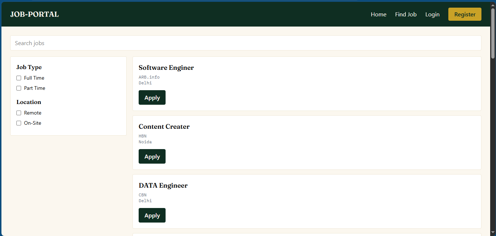
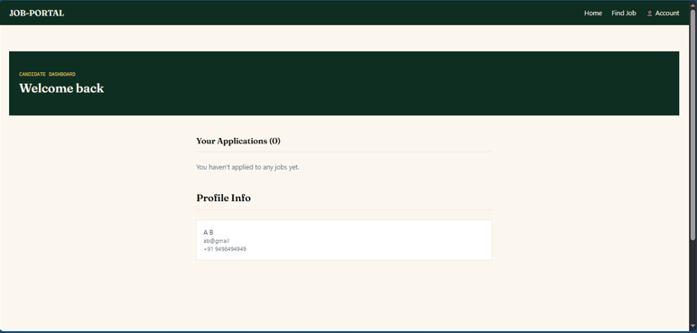
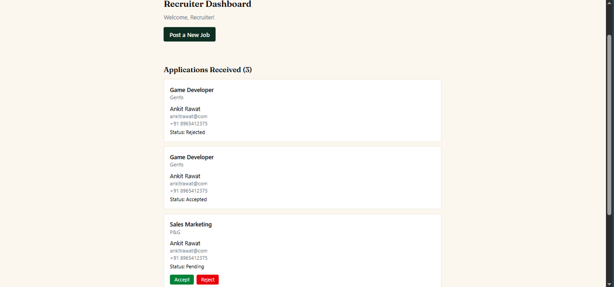
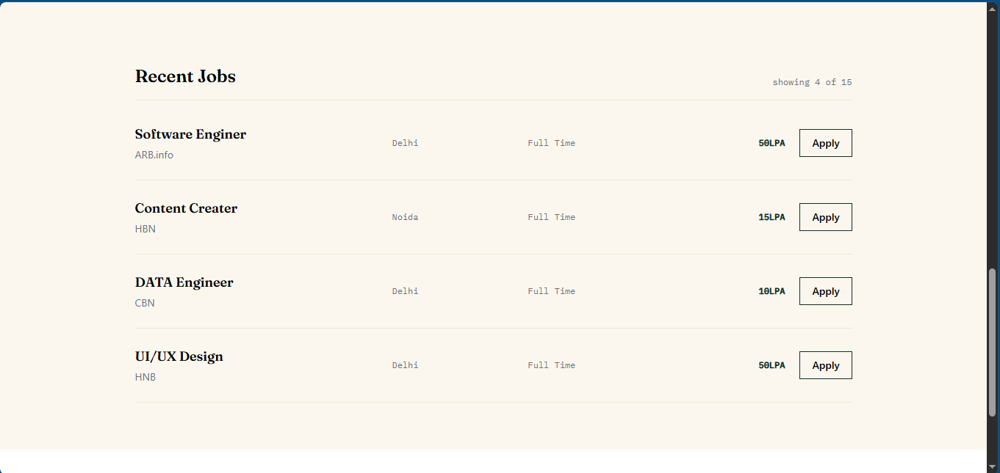

# 💼 Job Portal

A full-stack Job Portal web application built with the **MERN stack**. This platform allows candidates to explore job opportunities, apply for positions, upload resumes, and track applications. Recruiters can post job openings, manage listings, review applications, and update application statuses through a role-based authentication system.

## 🌐 Live Demo

- **Frontend:** [Job Portal](https://job-portal-morm.vercel.app)
- **Backend API:** [Backend API](https://job-portal-1p1h.onrender.com)
- **GitHub Repository:** [Job_Portal](https://github.com/abhishekprajapativns/Job_Portal)

## 🚀 Features

### 👨‍💼 Candidate

- Secure registration and login using JWT authentication
- Browse and search available job listings
- View detailed job information
- Apply for jobs through the platform
- Track application status: Pending, Accepted, or Rejected
- Upload a PDF resume to their profile
- Request a password reset using a time-limited token

### 🏢 Recruiter

- Recruiter registration and login with role-based authentication
- Create job listings with title, company, location, salary, description, skills, and category
- View, edit, and delete their own job postings
- View applications received for their job listings
- Access candidate contact details and uploaded resumes
- View and download candidate resumes
- Accept or reject applications
- Request a password reset using a time-limited token
- Make newly posted jobs available on the candidate job listing page

### 🔐 Common Features

- JWT-based authentication
- Role-based access control and protected routes
- Password hashing using `bcryptjs`
- Resume uploads using Multer
- Responsive user interface built with Tailwind CSS
- RESTful API architecture

## 🛠️ Tech Stack

### Frontend
- React.js
- Vite
- React Router DOM
- Tailwind CSS
- Axios

### Backend
- Node.js
- Express.js
- Multer

### Database
- MongoDB
- Mongoose
- MongoDB Atlas

### Authentication & Security
- JSON Web Token (JWT)
- bcryptjs
- Authentication middleware
- Role-based authorization

## 📸 Screenshots

Screenshots of the main pages and features of the application.

### 1. Find Jobs

Browse available job opportunities and explore relevant job listings.



### 2. Candidate Dashboard

Manage job applications and track their current status.



### 3. Recruiter Dashboard

Manage job postings and review applications submitted by candidates.



### 4. Job Details & Application

View job descriptions and apply for available positions.



## 📁 Project Structure

```text
Job_Portal/
│
├── public/                    # Static assets
├── screenshots/               # README screenshots
│   ├── find-jobs.png
│   ├── candidate-dashboard.png
│   ├── recruiter-dashboard.png
│   └── job-details.png
│
├── src/
│   ├── components/            # Reusable UI components
│   ├── Pages/                 # Application pages
│   ├── App.jsx                # Route definitions
│   └── main.jsx               # Application entry point
│
├── server/
│   ├── config/                # Database configuration
│   ├── controllers/            # Application business logic
│   ├── middleware/             # Authentication and file uploads
│   ├── models/                 # Mongoose schemas
│   ├── routes/                 # API route definitions
│   └── uploads/
│       └── resumes/            # Uploaded resumes (gitignored)
│
├── .gitignore
├── package.json
├── README.md
└── ...
```

*Note: The project structure above is illustrative. Adjust folder names and files to match the actual repository.*

## ⚙️ Installation and Setup

### Prerequisites

- Node.js and npm
- MongoDB Atlas account or a local MongoDB instance
- Git

### 1. Clone the Repository

```bash
git clone https://github.com/abhishekprajapativns/Job_Portal.git
cd Job_Portal
```

### 2. Set Up the Backend

Navigate to the backend folder:

```bash
cd server
npm install
```

Create a `.env` file inside the `server` folder and add your configuration:

```env
MONGO_URI=your_mongodb_connection_string
JWT_SECRET=your_jwt_secret
PORT=5000
```

Replace the placeholder values with your own configuration. Never commit your actual `.env` file or secret credentials to GitHub.

Start the backend server:

```bash
node index.js
```

The backend will run on the configured port, provided the database connection and configuration are valid.

### 3. Set Up the Frontend

Open a new terminal in the project root directory:

```bash
npm install
npm run dev
```

The frontend will run on the Vite development server, typically at:

http://localhost:5173

### 4. Configure the Frontend API URL

Ensure the frontend API configuration points to your local backend during development or to the deployed backend in production.

For example, if your application supports an environment variable for the API base URL, configure it according to your actual frontend code and deployment settings.

## 🔗 API Endpoints

The following endpoints document the application's API. Verify each route against the backend implementation before relying on this table.

### Authentication

| Method | Endpoint | Description | Authentication |
|---|---|---|---|
| POST | `/api/auth/register` | Register a candidate or recruiter | No |
| POST | `/api/auth/login` | Log in and receive authentication details | No |
| GET | `/api/auth/me` | Get the logged-in user's profile | Yes |
| POST | `/api/auth/upload-resume` | Upload a resume | Yes |
| POST | `/api/auth/forgot-password` | Request a password reset | No |
| POST | `/api/auth/reset-password` | Reset a password using a token | No |

### Jobs

| Method | Endpoint | Description | Authentication |
|---|---|---|---|
| GET | `/api/jobs` | Retrieve available job listings | No |
| GET | `/api/jobs/:id` | Retrieve job details | No |
| GET | `/api/jobs/my-jobs` | Retrieve jobs posted by the recruiter | Yes |
| POST | `/api/jobs` | Create a job listing | Yes |
| PATCH | `/api/jobs/:id` | Update a job listing | Yes |
| DELETE | `/api/jobs/:id` | Delete a job listing | Yes |

### Applications

| Method | Endpoint | Description | Authentication |
|---|---|---|---|
| POST | `/api/applications` | Apply for a job | Yes |
| GET | `/api/applications/my` | Retrieve the candidate's applications | Yes |
| GET | `/api/applications/recruiter` | Retrieve applications for the recruiter's jobs | Yes |
| PATCH | `/api/applications/:id/status` | Update an application's status | Yes |

## 🔐 Environment Variables & Security

- Keep `.env` files out of version control.
- Add `.env` and `node_modules/` to `.gitignore`.
- Use strong, unique secrets for JWT authentication.
- Validate uploaded files on the server, including file type and size.
- Restrict job editing, deletion, and application management to authorized users.
- Store production secrets in your hosting provider's environment settings.

## 🔮 Future Improvements

- Advanced job search and filtering by location, category, skills, and salary
- Email delivery for password reset links
- Toast notifications for user feedback
- Pagination for jobs and applications
- Admin dashboard for managing users and job listings
- Job recommendations based on candidate skills
- Recruiter analytics and application statistics

## 👨‍💻 Author

**Abhishek Prajapati**

Aspiring MERN Stack Developer

- **GitHub:** [abhishekprajapativns](https://github.com/abhishekprajapativns)

---

If you find this project useful, consider giving the repository a ⭐ on GitHub.
